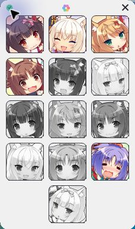

# NEKOPARA Extra 成就图标显示器

一个独立的小工具：在《NEKOPARA Extra》（Steam App ID `899970`）游戏窗口旁边贴一个成就面板，把 13 项成就以**图标**形式显示出来——未完成是黑白，已完成是彩色。不修改游戏，不联网，不注入。



## 特性

- **纯图标，无常驻文字**：主面板只显示 13 个成就图标，不显示成就名、进度条或其它文字。
- **黑白 / 彩色区分**：未完成灰色，已完成自动变彩色，读取的是本机 Steam 的实时成就缓存。
- **跟随游戏窗口**：自动贴合游戏窗口可见边框，右侧空间不足时自动尝试左侧。拖动顶部空白处可解除跟随、自由摆放。
- **圆角无描边**：主面板与指南弹窗使用真实圆角 Region，并禁用系统附加的白边。
- **中文成就指南**：鼠标悬停显示中文名称/说明/完成状态（已完成时含解锁日期）；左键点击图标打开对应的简体中文攻略步骤。
- **窗口外右键关闭指南**：指南可见时临时注册本进程低级鼠标钩子，仅在窗口任意位置右键即关闭指南（不注入游戏、不吞事件、不记录坐标），关闭后立即卸载。
- **背景色可选**：顶部调色按钮可选「游戏」（跟随游戏窗口边框配色）或「自选」（自定义 RGB，写入 `settings.txt`）。

## 顶部三个控件

| 位置 | 控件 | 说明 |
|---|---|---|
| 左 | 绿色勾形状态标志 | 已检测到游戏窗口 **且** 成功读取本机成就记录才显示绿色；否则灰色。悬停显示「已完成 X / 13」。 |
| 中 | 彩色调色按钮 | 打开独立小窗，选择「游戏」或「自选」背景模式。 |
| 右 | 加粗关闭 × | 深色背景下为纯白描边，浅色背景自动转深色。悬停提示「关闭」。 |

## 运行要求

- Windows（自带 .NET Framework 4.x）
- 本机安装并登录 Steam，且拥有 NEKOPARA Extra

## 使用

1. 解压 ZIP。
2. 双击 `NekoparaAchievementPanel.exe`。
3. **必须保留同目录的 `icons` 文件夹**（26 张成就图标）。

无需安装、无需 Python、无需账号密码、无后台联网。

## 从源码构建

```powershell
# 需要 .NET Framework 的 csc.exe
C:\Windows\Microsoft.NET\Framework64\v4.0.30319\csc.exe /target:winexe /out:NekoparaAchievementPanel.exe AchievementPanel.cs
```

编译后把 `icons` 文件夹与 `使用说明.txt` 放在 exe 同目录即可。

## 数据与安全

- 只**读取**本机 Steam 的成就定义与当前账号的成就缓存，不写入。
- **不修改**游戏目录、Steam 成就位图、存档、注册表或启动项。
- 设置与日志只写入工具自身所在目录。
- 发布包内**不含**任何本机缓存、账号数据、日志或备份。
- 26 张成就图标取自 Steam 官方 CDN。

## 已知限制

- 自动检测间隔 2 秒，依赖 Steam 的成就缓存落盘，**不保证与游戏内成就弹窗同步即时刷新**。
- 真实新成就解锁后的自动变色，未通过人为触发解锁事件做端到端验证。
- 缓存缺失或截断时显示「未知」，而不是当作未完成。

## 社区来源

中文攻略步骤优先采用本作专属的 Steam 社区指南：

- **Nekopara Extra - 100% Achievements Guide** — <https://steamcommunity.com/sharedfiles/filedetails/?id=2837077068>

内置步骤离线可读；点击社区链接才会用默认浏览器打开原帖。

---

# 发布与维护说明（仅仓库维护者需要）

## 上传 ZIP 到 GitHub

已发布版本：<https://github.com/kid19874-cmd/nekopara-achievement-panel/releases/tag/v1.0.0>

资产名固定为 **ASCII**（中文名会被 GitHub 截断成 `NEKOPARA-.zip`，已踩坑）：

```
NEKOPARA-Achievement-Panel-v1.0.0.zip
```

用本机凭证 + API 上传（脚本在 `C:\Users\99382\.dsh\agent-risk-log\browser-auth\`）：

```powershell
# 上传（追加到已有 release）
node gh-release-upload.mjs v1.0.0 "路径\NEKOPARA-Achievement-Panel-v1.0.0.zip"

# 替换（删旧资产 + 传新资产）
node gh-release-refresh-asset.mjs v1.0.0 "路径\新的.zip" "要删除的资产名关键词"
```

或直接用浏览器：仓库页 → **Releases** → **Edit** → 拖入 zip。

## 本机浏览器登录态（供自动化复用）

### 结论：登录态已自动持久化，无需手动恢复

DSH 浏览器把会话存在磁盘上：

| 项 | 路径 |
|---|---|
| 浏览器 profile | `C:\Users\99382\.dsh\dsh-builtin-browser-host\` |
| Cookie 数据库 | `C:\Users\99382\.dsh\dsh-builtin-browser-host\Network\Cookies` |

**实测（2026-10-17）**：GitHub 登录后 cookie 即时落盘；重开会话访问
`github.com/settings/profile` 仍为登录态，账号 **King (kid19874-cmd)**。
**浏览器重启、DSH 重启，登录态都还在。**

### 本机 GitHub 凭证

Windows 凭证管理器里存有可用于 API 的 token：

| 项 | 值 |
|---|---|
| Target | `LegacyGeneric:target=git:https://github.com` |
| User | `kid19874-cmd` |

读取（脚本在 `C:\Users\99382\.dsh\agent-risk-log\browser-auth\read-cred.ps1`）：

```powershell
powershell -NoProfile -ExecutionPolicy Bypass -File read-cred.ps1
```

输出格式 `用户名|base64`，**CredentialBlob 是 UTF-16LE 编码**。

### 什么情况下才要重新登录

清除浏览器数据、GitHub 侧会话过期（默认 2 周不活跃）、换机器或换 Windows 用户
（DPAPI 绑定当前用户）时。此时直接在浏览器窗口登录即可 —— 走 Google OAuth 需要
**手动过 reCAPTCHA**，这一步自动化替代不了。

> ⚠️ **安全提示**：`cookies.json` 等凭证文件等同账号密码。
> 不要提交进 git、不要上传网盘、不要贴进任何对话或日志。
